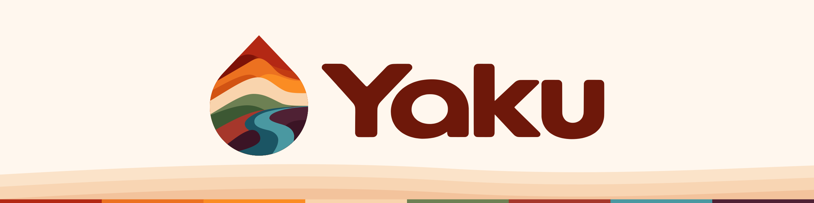
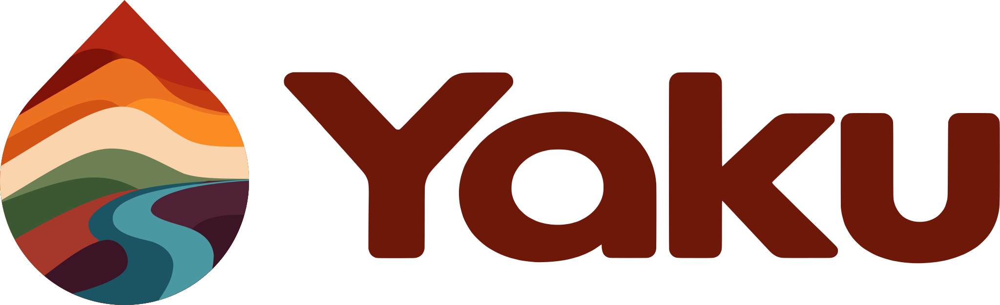
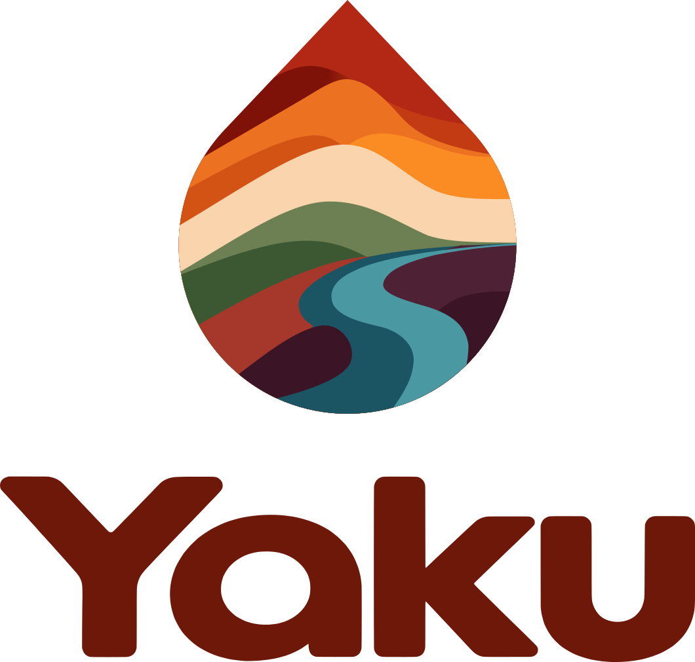
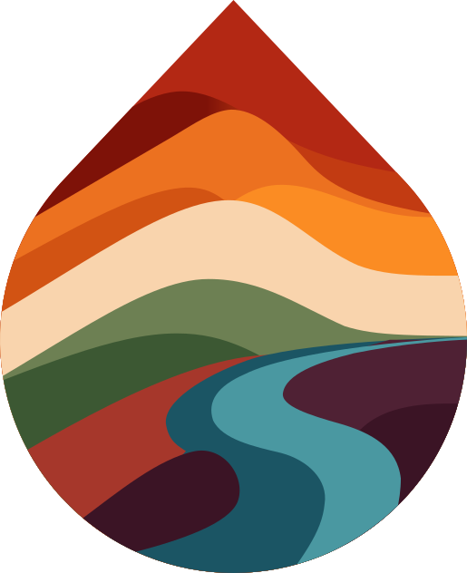
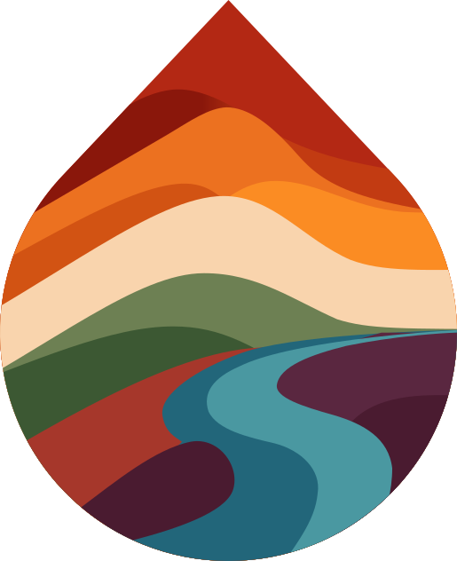
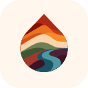
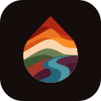
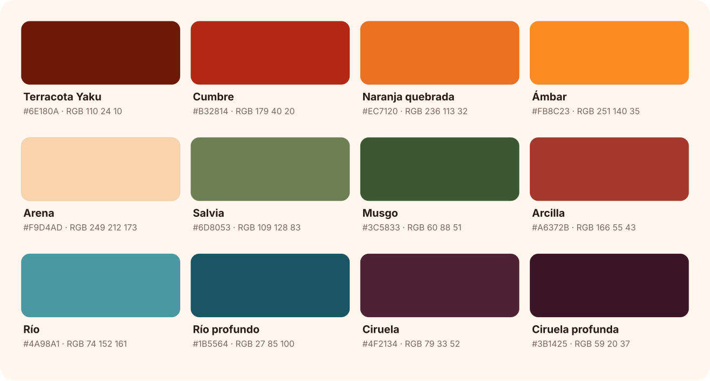
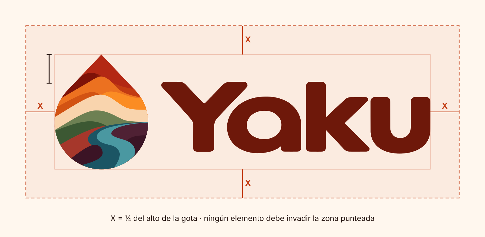

<p align="center">
  <picture>
    <source media="(prefers-color-scheme: dark)" srcset="social/yaku-banner-dark-2560x640.png">
    
  </picture>
</p>

# Yaku · Brand Kit

Sistema de identidad de **Yaku** listo para usar: logo vectorial redibujado, versiones para modo claro y oscuro, monocromos, íconos de app, favicons, imágenes sociales y guía de uso.

> Recomendado: ubicar esta carpeta en `docs/brand/` del repositorio. Todas las rutas de este documento son relativas a esa carpeta.
> Para ver el kit completo con descargas y paleta interactiva, abrí [`index.html`](index.html) (funciona en GitHub Pages).

---

## Contenido

```
brand/
├── README.md              ← esta guía
├── index.html             ← vitrina interactiva del kit (GitHub Pages)
├── svg/                   ← vectores maestros (usar siempre que se pueda)
│   ├── logo/              horizontal y apilado · claro / oscuro
│   ├── isotipo/           gota sola · ajustada, cuadrada y simplificada
│   ├── wordmark/          logotipo “Yaku” solo
│   ├── mono/              negro, blanco, terracota y arena
│   └── app-icon/          ícono redondeado, maskable y Apple
├── png/                   ← rasters con fondo transparente, de 16 px a 4096 px
├── webp/                  ← versiones livianas para web
├── pdf/                   ← vectoriales para imprenta
├── favicon/               ← .ico, .svg adaptativo, Apple, Android, manifest
├── social/                ← Open Graph, preview de GitHub, banners, avatares
├── guide/                 ← paleta y área de resguardo
└── source/                ← generador (Python) para reconstruir todo el kit
```

## Versiones del logo

| Versión | Fondo claro | Fondo oscuro | Cuándo usarla |
|---|:---:|:---:|---|
| **Horizontal** (principal) |  |  | Headers, README, web, documentos |
| **Apilado** |  |  | Espacios cuadrados, portadas, merch |
| **Isotipo** |  |  | Avatares, íconos, marca de agua |
| **Isotipo simplificado** |  |  | **Solo** entre 16 y 32 px (favicons) |
| **Logotipo** |  |  | Cuando la gota ya aparece cerca |
| **Ícono de app** |  |  | Stores, PWA, launcher |

### Monocromos

Para una sola tinta (sellos, grabado láser, bordado, serigrafía, fondos fotográficos). La gota conserva el río y los estratos como calados.

| Negro | Blanco | Terracota | Arena |
|:---:|:---:|:---:|:---:|
|  |  |  |  |

> Las variantes blanca y arena están pensadas para fondos oscuros: en esta tabla pueden no verse si GitHub está en modo claro.

## Modo claro / oscuro en GitHub

GitHub respeta `prefers-color-scheme` dentro de `<picture>`. Pegá esto en el `README.md` raíz del repo:

```html
<p align="center">
  <picture>
    <source media="(prefers-color-scheme: dark)" srcset="docs/brand/svg/logo/yaku-horizontal-dark.svg">
    <source media="(prefers-color-scheme: light)" srcset="docs/brand/svg/logo/yaku-horizontal.svg">
    
  </picture>
</p>
```

Para la **vista previa social del repositorio** (Settings → General → Social preview) subí `social/yaku-github-social-light-1280x640.png` o su versión `dark`.

## Paleta

<picture>
  <source media="(prefers-color-scheme: dark)" srcset="guide/yaku-palette-dark.png">
  
</picture>

| Color | HEX | RGB | Rol |
|---|---|---|---|
| Terracota Yaku | `#6E180A` | 110 24 10 | Logotipo sobre claro · color de marca para UI |
| Arena | `#F9D4AD` | 249 212 173 | Logotipo sobre oscuro · estrato de la gota |
| Cumbre | `#B32814` | 179 40 20 | Gota |
| Naranja quebrada | `#EC7120` | 236 113 32 | Gota · acento cálido |
| Ámbar | `#FB8C23` | 251 140 35 | Gota |
| Salvia | `#6D8053` | 109 128 83 | Gota |
| Musgo | `#3C5833` | 60 88 51 | Gota |
| Arcilla | `#A6372B` | 166 55 43 | Gota |
| Río | `#4A98A1` | 74 152 161 | Gota · acento frío |
| Río profundo | `#1B5564` | 27 85 100 | Gota |
| Ciruela | `#4F2134` | 79 33 52 | Gota |
| Ciruela profunda | `#3B1425` | 59 20 37 | Gota |
| Blanco cálido | `#FFF7EE` | 255 247 238 | Fondo claro de marca |
| Noche | `#140D0C` | 20 13 12 | Fondo oscuro de marca |

**Contraste (WCAG):** Terracota sobre blanco cálido ≈ 11,0 : 1 · Arena sobre Noche ≈ 13,8 : 1. Ambos superan AAA.

<details>
<summary>Tokens CSS</summary>

```css
:root {
  --yaku-terracota: #6E180A;
  --yaku-arena: #F9D4AD;
  --yaku-cumbre: #B32814;
  --yaku-naranja: #EC7120;
  --yaku-ambar: #FB8C23;
  --yaku-salvia: #6D8053;
  --yaku-musgo: #3C5833;
  --yaku-arcilla: #A6372B;
  --yaku-rio: #4A98A1;
  --yaku-rio-profundo: #1B5564;
  --yaku-ciruela: #4F2134;
  --yaku-ciruela-profunda: #3B1425;
  --yaku-papel: #FFF7EE;
  --yaku-noche: #140D0C;
}
```
</details>

## Área de resguardo y tamaño mínimo



La unidad **X** equivale a ¼ del alto de la gota. Ningún texto, borde ni imagen debe invadir esa zona.

| Versión | Mínimo digital | Mínimo impreso |
|---|---|---|
| Horizontal | 120 px de ancho | 30 mm de ancho |
| Apilado | 72 px de ancho | 18 mm de ancho |
| Isotipo completo | 40 px de alto | 10 mm de alto |
| Isotipo simplificado | 16 px | — (solo pantalla) |

## Favicons y PWA

Copiá el contenido de `favicon/` a la raíz pública del sitio y agregá en el `<head>`:

```html
<link rel="icon" href="/favicon.ico" sizes="48x48">
<link rel="icon" href="/favicon.svg" type="image/svg+xml">
<link rel="apple-touch-icon" href="/apple-touch-icon.png">
<link rel="manifest" href="/site.webmanifest">
<link rel="mask-icon" href="/safari-pinned-tab.svg" color="#6E180A">
<meta name="theme-color" content="#FFF7EE" media="(prefers-color-scheme: light)">
<meta name="theme-color" content="#140D0C" media="(prefers-color-scheme: dark)">
<meta property="og:image" content="https://TU-DOMINIO/social/yaku-og-light-1200x630.png">
```

`favicon.svg` se adapta solo: cuando la pestaña está en modo oscuro eleva las sombras de la gota para que no se pierda contra el fondo.

## Imágenes sociales

| Archivo | Tamaño | Uso |
|---|---|---|
| `social/yaku-og-{light,dark}-1200x630.{png,jpg}` | 1200 × 630 | Open Graph / Twitter / LinkedIn |
| `social/yaku-github-social-{light,dark}-1280x640.{png,jpg}` | 1280 × 640 | Social preview del repo |
| `social/yaku-banner-{light,dark}-{1280x320,2560x640}.png` | 4 : 1 | Encabezado de README, docs |
| `social/yaku-avatar-{light,dark}-{500,1024}.png` | cuadrado | Perfil de GitHub, redes, Discord |

Las fuentes vectoriales de todas están en `social/svg/`.

## Usos incorrectos

- No deformar ni estirar el logo: escalar siempre de forma proporcional.
- No recolorear los estratos de la gota ni aplicar degradados nuevos.
- No usar el logotipo terracota sobre fondos oscuros: para eso existe la versión arena.
- No usar el isotipo completo por debajo de 40 px: usar el simplificado.
- No agregar sombras, contornos, brillos ni efectos 3D.
- No rotar la gota ni cambiar la proporción entre gota y logotipo.
- No ubicar el logo sobre fotos con mucho detalle sin una placa de fondo o una versión monocromo.

## Qué se mejoró respecto del original

1. **Redibujo vectorial completo.** El original era un raster con bordes irregulares; ahora es SVG limpio que escala sin pérdida a cualquier tamaño.
2. **Gota geométricamente exacta.** Círculo perfecto y tangentes reales hasta el vértice: la silueta queda simétrica (antes estaba levemente torcida hacia la derecha).
3. **Más aire entre gota y logotipo.** La separación pasó de 38 a 72 unidades: el conjunto respira y se lee mejor en tamaños chicos.
4. **Paleta normalizada.** 14 colores con nombre y valor fijo, en lugar de tonos que variaban por el antialiasing del archivo original.
5. **Versión para modo oscuro real.** Logotipo en arena y sombras de la gota (ciruelas, río profundo) elevadas para que no se fundan con fondos oscuros.
6. **Isotipo simplificado para favicons.** Menos estratos y río más ancho: a 16 px se sigue leyendo gota + río.
7. **Monocromo con calados.** La gota a una tinta conserva su identidad (río y estratos en negativo) en lugar de ser una mancha.
8. **Centrado óptico en íconos.** La gota se sube levemente dentro del cuadrado porque su masa visual está abajo.

## Regenerar el kit

Todo se genera desde `source/` (un único origen de verdad). Si cambiás un color o una proporción en `source/yaku.py`:

```bash
# Requisitos: Python 3.10+, Pillow, librsvg (rsvg-convert) e ImageMagick
pip install pillow
python3 source/build.py        # reescribe svg/, png/, webp/, pdf/, favicon/, social/ y guide/
```
